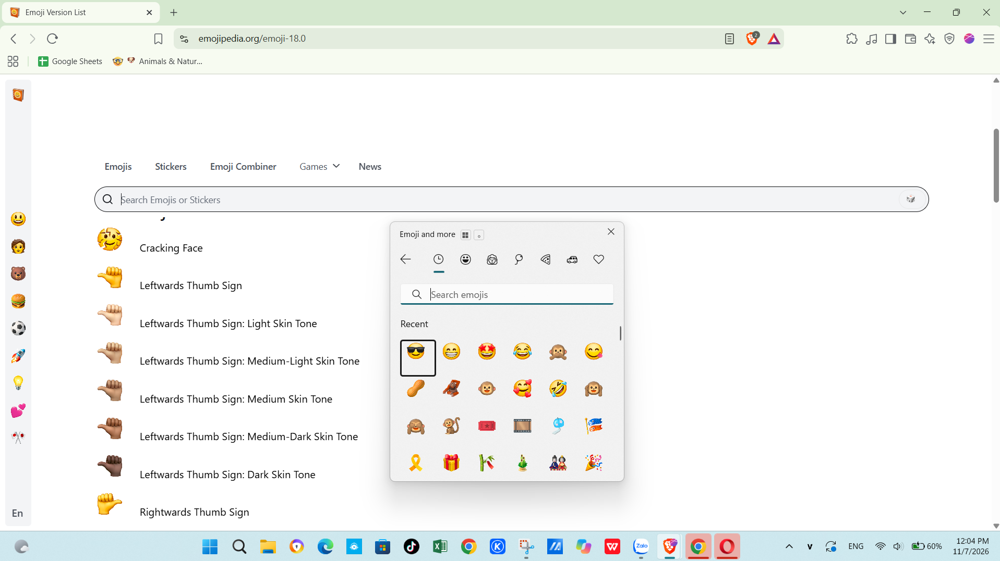
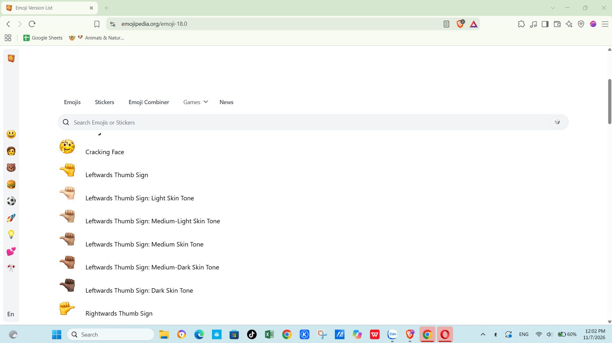
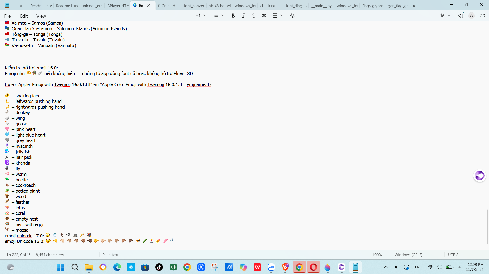

# 🌍 Unicode Flags for Windows — Emoji Picker + Unicode 17.0 & 18.0 Support
# Add Country Flag Emojis to Windows 10-11

This project helps Windows 10 & 11 display full-color flag emojis 🇻🇳🇺🇸🇯🇵 and complete Unicode emoji sets:
- **Unicode 17.0**: 🫪🫯🫈🧑‍🩰🫍🛘🪊🪎
- **Unicode 18.0**: 🫫🫹🫹🏻🫹🏼🫹🏽🫹🏾🫹🏿 🫺🫺🏻🫺🏼🫺🏽🫺🏾🫺🏿 🫌🫝🛙🪋🪌🪍

📌 **Version Note**
Documentation and screenshots in this repository are based on Twemoji and Unicode standards.
Display of newer emojis (16.0, 17.0, 18.0 🫫...) depends on the font package you install.

👉 **Latest font with full Emoji 18.0 support built by me** — see the **Releases** section of this repository:
- ✅ **Noto Color Emoji 18.0 2D** — stable, recommended for daily use ⭐
- ✅ **seguiemj_1_33_mod_CN_fixed.ttf** — fixes incorrect China flag 🇨🇳 (resolves issue #3)
- ⏳ **Noto Color Emoji 18.0 3D** — in progress, coming soon

🙌 Credits: Thanks to @Chasmical, @jjjuk and the community for valuable foundations.

📘 Available in:
- 🇺🇸 [English](./README.md) ← You are here
- 🇻🇳 [Tiếng Việt](./README.vi.md)
- 🇨🇳 [中文](./README.zh.md)
- 🇷🇺 [Русский](./README.ru.md)

---

## unicode-flags-for-windows 🇻🇳

**tuannvbg** — Vietnamese developer determined to make national flag emojis display correctly on Windows 😎🇻🇳🇺🇸

---

## ✨ Overview
Windows 10 and 11 do not natively display full-color Unicode flag emojis (e.g. 🇻🇳 🇺🇸 🇯🇵 🇫🇷 🇩🇪). This repository provides a complete solution — from system font patching to browser configuration.

No waiting for Microsoft. No half-measures. This is a technical fix built with determination and understanding.

## 🔧 Features
- Patches `Segoe UI Emoji` font with full `COLR/CPAL` color table support
- Registry updates to load the custom font
- Optimized for Chrome, Edge, Firefox
- Preserves original font weight and spacing
- Works on both **Windows 10** and **Windows 11**

## 📚 Installation Guides
- 🇺🇸 [English](./guides/windows.en.md)
- 🇻🇳 [Tiếng Việt](./guides/windows.vi.md)
- 🇨🇳 [中文](./guides/windows.zh.md)
- 🇷🇺 [Русский](./guides/windows.ru.md)
- 🌐 [Other languages](./guides/) (coming soon)

---

## 🧩 Emoji Picker & Unicode Versions — Technical Discovery

### ✅ Recommended Installation Method
Here's what I discovered: installing `Segoe.UI.Emoji.with.Twemoji.Flags.ttf` lets you:
- ✅ Enjoy the Windows 11-style emoji picker on Windows 10
- ✅ Display full Unicode 17.0 emojis: 🫪🫯🫈🧑‍🩰🫍🛘🪊🪎
- ✅ Render full-color national flag emojis: 🇻🇳🇺🇸🇯🇵

---

### 🔹 Step 1: Follow the setup guide
📖 [Installation Guide →](./guides/windows.en.md)

### 🔹 Step 2: Install the flag-support font
📁 Font: [`Segoe.UI.Emoji.with.Twemoji.Flags.ttf`](https://github.com/Chasmical/flag-emojis-for-windows)  
📁 Or download from [`/fonts/`](https://github.com/tuannvbg/unicode-flags-for-windows/tree/main/fonts)

- ✅ Displays full-color flag emojis (e.g. 🇯🇵🇫🇷🇧🇷)
- ✅ Works with Windows Emoji Picker (`Win + .`)
- 🧩 Combines Segoe UI Emoji v1.70 + Twemoji v17.0.3
- 📌 This font **complements** — does not fully replace — your system font

---

### 🔍 Technical Insight: Font Stacking for Extended Support

`seguiemj_1_31_mod.ttf` already supports flag emojis, but being based on the original Windows 10 font, emoji visuals are older — not as polished as Windows 11's Fluent 3D style.

→ That's why I use `Segoe.UI.Emoji.with.Twemoji.Flags.ttf` by Chasmical to:
- ✅ Keep full-color flag emojis
- ✅ Get Windows 11-quality Fluent 3D visuals (Segoe UI Emoji v1.70 base)
- ✅ Combine with `seguiemj_1_31_mod.ttf` to add Unicode 17.0 coverage

📌 Technical details:
- Chasmical's font **does not replace all emojis** — it adds **262 flag emojis** from Twemoji v17.0.3
- Remaining emojis use `Segoe UI Emoji v1.70` — Fluent 3D, Windows 11 26H2 (2026-08-27)
- From Chasmical's repository:

  > *"This font is based on Segoe UI Emoji v1.70 (https://emojipedia.org/microsoft-3D-fluent/windows-11-26h2-august-2026-update; Windows 11 26H2; 2026-08-27) and contains 262 flags from Twemoji v17.0.3 (https://github.com/jdecked/twemoji/commit/b6b55fef1e8636b540a6d016a4729ca8cdf2e60b; 2026-06-01)"*

🧠 Install `seguiemj_1_31_mod.ttf` first — the system falls back to it for Unicode 17.0+ emojis not present in Chasmical's font.
→ **Smart font stacking**:
- Primary font → newer Unicode glyphs
- Secondary font → Fluent visuals + flag emojis
- **Result**: Windows 10 displays like Windows 11 — with even better Unicode 17.0 support
### 🇨🇳 China flag fix (issue #3)
`seguiemj_1_33_mod.ttf` previously showed an incorrect historical flag for 🇨🇳.  
The fixed version `seguiemj_1_33_mod_CN_fixed.ttf` replaces it with the modern PRC flag.  
Idea: **Tuannvbg** — Implementation: **Grok (xAI)**.
---

### 📷 Browser Configuration for Correct Flag Colors
After installing the font, configure your browser to render flags properly:

✅ **Tip**: Set `'Noto Color Emoji'` as the preferred emoji font instead of `'Segoe UI Emoji'` to avoid blue-tinted or missing flags.

---

### 📸 Real-World Screenshots

#### 🧩 Windows 11-Style Picker on Windows 10

---

#### 🌐 Chrome with `'Noto Color Emoji'`

---

#### 🌐 Edge with `'Noto Color Emoji'`

---

#### 🔍 Emojipedia.org — Unicode 17.0 Test

---

#### ✨ Noto Color Emoji 18.0 — 2D Edition (New!)
**Brave Browser — Picker with Unicode 18.0**

**Brave Browser — Unicode 18.0 on Page**

**Notepad — System-Level Verification**

---

### 🧪 Compatibility Table

| OS + Font Setup | Unicode 17.0 | Unicode 18.0 | Flag Emojis | Notes |
|---|---|---|---|---|
| Win10 + `seguiemj_1_31_mod.ttf` | ✅ | ❌ | ✅ | Full set, legacy visuals |
| Win10 + `seguiemj_1_31_mod.ttf` + Twemoji Flags | ✅ | ❌ | ✅ | Fluent style, lacks 18.0 |
| Win11 + `seguiemj_1_33_mod_CN_fixed.ttf` | ✅ | ❌ | ✅ | Fixed China flag 🇨🇳 (issue #3) |
| Win11 + Twemoji Flags only | ✅ | ❌ | ✅ | Chasmical's latest — v1.70, 262 flags, has 17.0, missing 18.0 |
| Win11 + `Noto-Color-Emoji-18.0-2D-for-Windows.ttf` | ✅ | ✅ | ✅ | ⭐ **Recommended** — full support, unified design |

---

### 📢 Conclusion
✅ **Windows 10 can fully display flag emojis + Unicode 17.0**  
Install in the right order: **base font first**, **Twemoji Flags second**,  
and configure your browser to use `'Noto Color Emoji'` for perfect flag colors.

✅ **For full Unicode 18.0**: Get `Noto-Color-Emoji-18.0-2D-for-Windows.ttf` from Releases ⭐

---

## 🦊 Global Challenge: Fix Flags in Firefox

> Firefox still doesn't render Unicode flag emojis correctly.  
> Whoever solves this will be honored on the [Firefox Wall of Fame](guides/firefox.wall-of-fame.en.md) 🏅

- 🌍 [View the Challenge](guides/firefox.prefix.en.md)
- 🛠️ [Submit Your Fix](guides/firefox.fix.template.en.md)

---

## 🤔 Comparison with Other Projects

| Criteria | twemoji-color-font | unicode-flags-for-windows |
|---|---|---|
| Flags render correctly? | ⚠️ System-dependent | ✅ Stable, native Unicode |
| Full-color other emojis? | ❌ Mostly B&W | ✅ Full color + Unicode 18.0 |
| Modifies system fonts? | ❌ No | ✅ Yes (with backup) |
| Optimized for Windows 10/11? | ❌ Not Windows-focused | ✅ Built specifically for Windows |
| Requires registry edits? | ❌ No | ✅ Yes (auto/manual) |
| Firefox support? | ❌ Not targeted | ❓ Challenge open |
| Latest Unicode support | ⚠️ Varies | ✅ **17.0 + 18.0** |

---

🙌 Credits
- https://github.com/tuannvbg/unicode-flags-for-windows#-credits
- https://github.com/Chasmical/flag-emojis-for-windows
- https://github.com/perguto/Country-Flag-Emojis-for-Windows
- https://llccd.eu.org/2022/02/win_flags
- https://github.com/13rac1/twemoji-color-font
- https://github.com/jjjuk/emoji-win

- Copilot AI — technical brainstorming partner
- ChatGPT — technical brainstorming partner
- Grok — technical brainstorming partner
- Dola AI — technical brainstorming & writing partner

**tuannvbg** 🇻🇳 — Making national flag emojis display correctly on Windows 😎✨

## 🇻🇳 Tiếng Việt

### ✨ Giới thiệu
Windows 10 và 11 vốn không hỗ trợ đầy đủ emoji cờ quốc gia theo chuẩn Unicode (ví dụ: 🇻🇳 🇺🇸 🇯🇵 🇫🇷 🇩🇪). Kho mã này cung cấp giải pháp hoàn chỉnh để vá hệ thống, giúp emoji cờ hiển thị đúng màu trên mọi ứng dụng — hiện đã hỗ trợ đầy đủ **Unicode 17.0 & 18.0**.

Không cần chờ cập nhật từ Microsoft. Không giải pháp nửa vời. Đây là bản sửa lỗi kỹ thuật, được xây dựng trên sự kiên trì, hiểu sâu về hệ thống và với sự hỗ trợ của cộng đồng.

## 📚 Hướng dẫn cài đặt

🌐 Xem các phiên bản ngôn ngữ khác:
- 🇻🇳 [Tiếng Việt](./guides/windows.vi.md)
- 🇺🇸 [English](./guides/windows.en.md)
- 🇨🇳 [中文](./guides/windows.zh.md)
- 🇷🇺 [Русский](./guides/windows.ru.md)

---

## 🌟 Tin mới: Unicode 18.0 & Noto Color Emoji Phiên bản 2D

### ✨ Cập nhật — Tháng 11 năm 2026
- ⭐ **Hỗ trợ đầy đủ Unicode 17.0**: 🫪🫯🫈🧑‍🩰🫍🛘🪊🪎
- ✨ **Hỗ trợ mới Unicode 18.0**: 🫫🫝🫌🛙🪋🪌🪍🫹🫺 (bao gồm tất cả biến thể màu da)
- 🎨 **Noto Color Emoji 18.0 — Phiên bản 2D**: gọn nhẹ, ổn định, khuyến nghị dùng hàng ngày ⭐
- ✅ **seguiemj_1_33_mod_CN_fixed.ttf** — sửa lỗi cờ Trung Quốc 🇨🇳 (giải quyết issue #3)
- ⏳ **Noto Color Emoji Phiên bản 3D** — phong cách sống động hơn, đang phát triển, sắp ra mắt!

### 📦 Khuyến nghị — Noto Color Emoji 18.0 2D
Cài đặt `Noto-Color-Emoji-18.0-2D-for-Windows.ttf` để có trải nghiệm hoàn chỉnh nhất:
- ✅ Emoji cờ quốc gia hiển thị đầy đủ màu sắc 🇻🇳🇺🇸🇯🇵
- ✅ Hỗ trợ toàn bộ emoji Unicode 17.0 + 18.0
- ✅ Phong cách thiết kế 2D thống nhất trên mọi ứng dụng
- ✅ Đã kiểm tra trên **Windows 11** ✅ — Rất mong nhận được phản hồi từ người dùng Windows 10 🙏
  
### 🇨🇳 Sửa cờ Trung Quốc (issue #3)
`seguiemj_1_33_mod.ttf` trước đây hiển thị cờ lịch sử sai cho 🇨🇳.  
Bản sửa `seguiemj_1_33_mod_CN_fixed.ttf` thay bằng cờ PRC hiện đại.  
Ý tưởng: **Tuannvbg** — Thực hiện: **Grok (xAI)**.

📖 [Xem hướng dẫn cài đặt →](./guides/windows.vi.md)

---

## 🧩 Bảng chọn Emoji & Phiên bản Unicode — Chi tiết kỹ thuật

### ✅ Hai cách để có bộ emoji đầy đủ

#### Cách 1: Noto Color Emoji 18.0 2D (Khuyến nghị ⭐)
- Tệp: `Noto-Color-Emoji-18.0-2D-for-Windows.ttf`
- Hỗ trợ: **Unicode 17.0 + 18.0** ✅✅
- Cờ quốc gia: Đúng màu theo chuẩn Twemoji ✅
- Đã kiểm tra trên: Windows 11 ✅

#### Cách 2: Kết hợp nhiều font (Phương pháp cũ)
Bằng cách cài cả `Segoe.UI.Emoji.with.Twemoji.Flags.ttf` + `seguiemj_1_31_mod.ttf`:
- ✅ Sử dụng được bảng chọn emoji kiểu Windows 11 trên Windows 10
- ✅ Emoji cờ quốc gia hiển thị đầy đủ màu sắc
- ✅ Hỗ trợ Unicode 17.0: 🫪🫯🫈🧑‍🩰🫍🛘🪊🪎
- ⚠️ **Chưa hỗ trợ Unicode 18.0** — font của Chasmical chỉ cung cấp 17.0

---

### 🔹 Cách hoạt động của việc kết hợp font
- `Segoe.UI.Emoji.with.Twemoji.Flags.ttf` (tác giả Chasmical): bổ sung **262 biểu tượng cờ quốc gia** từ Twemoji v17.0.3, dựa trên Segoe UI Emoji v1.70 (Fluent 3D; Windows 11 26H2; 27/08/2026)
- `seguiemj_1_31_mod.ttf`: cung cấp các ký tự Unicode mới bao gồm 17.0
- **Kết quả**: Có cờ + emoji mới, nhưng vẫn thiếu Unicode 18.0

> Trích từ kho mã của Chasmical:
> *"Font này dựa trên Segoe UI Emoji v1.70 (https://emojipedia.org/microsoft-3D-fluent/windows-11-26h2-august-2026-update; Windows 11 phiên bản 26H2; 27/08/2026) và chứa 262 cờ quốc gia từ Twemoji v17.0.3 (https://github.com/jdecked/twemoji/commit/b6b55fef1e8636b540a6d016a4729ca8cdf2e60b; 01/06/2026)"*

---

### 📸 Hình ảnh thực tế

#### 🧩 Bảng chọn Emoji kiểu Windows 11 trên Windows 10

---

#### 🌐 Noto Color Emoji 18.0 2D — Trình duyệt Brave (Mới!)
**Trình duyệt Brave — Bảng chọn hiển thị đầy đủ Unicode 18.0**

**Trình duyệt Brave — Hiển thị Unicode 18.0 trên trang web**

**Sổ tay — Kiểm tra hiển thị trực tiếp trong hệ thống**

---

#### 🌐 Chrome sau khi đặt font `'Noto Color Emoji'`

---

### 🧪 Bảng tương thích hệ thống

| Hệ điều hành + Font | Unicode 17.0 | Unicode 18.0 | Cờ quốc gia | Ghi chú |
|---|---|---|---|---|
| Win10 + `seguiemj_1_31_mod.ttf` | ✅ | ❌ | ✅ | Đầy đủ, giao diện kiểu cũ |
| Win10 + `seguiemj_1_31_mod.ttf` + Twemoji Flags | ✅ | ❌ | ✅ | Giao diện đẹp, thiếu 18.0 |
| Win11 + `seguiemj_1_33_mod_CN_fixed.ttf` | ✅ | ❌ | ✅ | Đã sửa cờ Trung Quốc 🇨🇳 (issue #3) |
| Win11 + chỉ Twemoji Flags | ✅ | ❌ | ✅ | Phiên bản mới nhất của Chasmical — có 17.0, thiếu 18.0 |
| Win11 + `Noto-Color-Emoji-18.0-2D-for-Windows.ttf` | ✅ | ✅ | ✅ | ⭐ **Khuyến nghị** — đầy đủ nhất, thiết kế thống nhất |

---

### 📢 Kết luận
✅ **Để có trải nghiệm đầy đủ Unicode 18.0**: Hãy cài `Noto-Color-Emoji-18.0-2D-for-Windows.ttf` — giải pháp hoàn chỉnh nhất hiện có.
✅ **Người dùng Windows 10**: Kết hợp font vẫn hoạt động tốt cho cờ + 17.0; rất mong nhận được phản hồi khi thử nghiệm 18.0 🙏

---

## 🦊 Thử thách toàn cầu: Sửa lỗi hiển thị cờ quốc gia trên Firefox

> Firefox vẫn chưa hiển thị đúng emoji cờ quốc gia theo chuẩn Unicode.
> Ai giải quyết được sẽ được vinh danh tại [Bảng Vinh danh Firefox](guides/firefox.wall-of-fame.vi.md) 🏅

- 🌍 [Xem chi tiết thử thách](guides/firefox.prefix.vi.md)
- 🛠️ [Gửi phương án sửa lỗi của bạn](guides/firefox.fix.template.vi.md)

---

## 🤔 So sánh với các giải pháp khác

| Tiêu chí | twemoji-color-font | unicode-flags-for-windows |
|---|---|---|
| Cờ quốc gia hiển thị đúng? | ⚠️ Phụ thuộc hệ thống | ✅ Ổn định, theo chuẩn Unicode gốc |
| Emoji khác có hiển thị màu? | ❌ Chủ yếu đen trắng | ✅ Đầy đủ màu + Unicode 18.0 |
| Thay đổi font hệ thống? | ❌ Không | ✅ Có (có bản sao lưu) |
| Tối ưu cho Windows 10/11? | ❌ Không tập trung | ✅ Xây dựng riêng cho Windows |
| Cần chỉnh sửa Registry? | ❌ Không | ✅ Có (tự động / thủ công) |
| Hỗ trợ Firefox? | ❌ Không hướng đến | ❓ Đang là thử thách |
| Hỗ trợ Unicode mới nhất | ⚠️ Khác nhau theo phiên bản | ✅ **17.0 + 18.0** |

---

🙌 Ghi nhận
- https://github.com/tuannvbg/unicode-flags-for-windows#-credits
- https://github.com/Chasmical/flag-emojis-for-windows
- https://github.com/perguto/Country-Flag-Emojis-for-Windows
- https://llccd.eu.org/2022/02/win_flags
- https://github.com/13rac1/twemoji-color-font
- https://github.com/jjjuk/emoji-win

- Copilot AI — Đối tác hỗ trợ tư duy kỹ thuật
- ChatGPT — Đối tác hỗ trợ tư duy kỹ thuật
- Grok — Đối tác hỗ trợ tư duy kỹ thuật
- Dola AI — Đối tác hỗ trợ tư duy & biên soạn nội dung

**tuannvbg** 🇻🇳 — Làm cho emoji cờ quốc gia hiển thị đúng trên Windows 😎✨

## 🇨🇳 简体中文

### ✨ 项目简介
Windows 10 和 11 原生无法完整显示 Unicode 标准国旗表情符号（例如：🇻🇳 🇺🇸 🇯🇵 🇫🇷 🇩🇪）。本项目提供完整解决方案，通过系统级修复，让国旗在所有应用中正常彩色显示 — 现已全面支持 **Unicode 17.0 与 18.0**。

无需等待微软更新，不做半吊子方案。这是一套基于深入理解系统原理、持之以恒完成的技术修复，也离不开社区的鼎力支持。

## 📚 安装指南

🌐 查看其他语言版本：
- 🇻🇳 [越南语](./guides/windows.vi.md)
- 🇺🇸 [英语](./guides/windows.en.md)
- 🇨🇳 [简体中文](./guides/windows.zh.md)
- 🇷🇺 [俄语](./guides/windows.ru.md)

---

## 🌟 新特性：Unicode 18.0 与 Noto 彩色表情 2D 版

### ✨ 2026 年 11 月更新
- ⭐ **全面支持 Unicode 17.0**：🫪🫯🫈🧑‍🩰🫍🛘🪊🪎
- ✨ **全新支持 Unicode 18.0**：🫫🫝🫌🛙🪋🪌🪍🫹🫺（含所有肤色变体）
- 🎨 **Noto 彩色表情 18.0 — 2D 版**：轻量稳定，推荐日常使用 ⭐
- ✅ **seguiemj_1_33_mod_CN_fixed.ttf** — 修复错误的中国国旗 🇨🇳（解决 issue #3）
- ⏳ **Noto 3D 版**：更生动立体的样式，开发中，敬请期待！

### 📦 推荐方案 — Noto 彩色表情 18.0 2D 版
安装 `Noto-Color-Emoji-18.0-2D-for-Windows.ttf` 获得最完整体验：
- ✅ 各国国旗彩色正常显示 🇻🇳🇺🇸🇯🇵
- ✅ 同时支持 Unicode 17.0 + 18.0 全部表情
- ✅ 全应用统一 2D 视觉风格
- ✅ 已在 **Windows 11** 实测通过 ✅ — 欢迎 Windows 10 用户反馈体验 🙏
  
### 🇨🇳 中国国旗修复（issue #3）
`seguiemj_1_33_mod.ttf` 此前显示的是错误的历史旗帜 🇨🇳。  
修复版 `seguiemj_1_33_mod_CN_fixed.ttf` 已替换为现代中华人民共和国国旗。  
想法：**Tuannvbg** — 实现：**Grok (xAI)**。

📖 [查看安装指南 →](./guides/windows.zh.md)

---

## 🧩 表情选择器与 Unicode 版本 — 技术细节

### ✅ 两种实现方案

#### 方案一：Noto 彩色表情 18.0 2D 版（推荐 ⭐）
- 文件：`Noto-Color-Emoji-18.0-2D-for-Windows.ttf`
- 支持：**Unicode 17.0 + 18.0** ✅✅
- 国旗：采用 Twemoji 配色标准 ✅
- 实测环境：Windows 11 ✅

#### 方案二：字体叠加方案（传统方式）
同时安装 `Segoe.UI.Emoji.with.Twemoji.Flags.ttf` + `seguiemj_1_31_mod.ttf`：
- ✅ Windows 10 也能用上 Windows 11 风格的表情选择器
- ✅ 国旗彩色正常显示
- ✅ 支持 Unicode 17.0：🫪🫯🫈🧑‍🩰🫍🛘🪊🪎
- ⚠️ **暂不支持 Unicode 18.0** — Chasmical 的字体仅包含 17.0 内容

---

### 🔹 字体叠加原理
- `Segoe.UI.Emoji.with.Twemoji.Flags.ttf`（作者：Chasmical）：基于 Segoe UI Emoji v1.70（Fluent 3D 风格；Windows 11 26H2；2026-08-27），新增 **262 面国旗**，源自 Twemoji v17.0.3
- `seguiemj_1_31_mod.ttf`：提供 Unicode 17.0 等新字符
- **结果**：国旗 + 新表情可用，但仍缺少 Unicode 18.0

> 引自 Chasmical 项目说明：
> *"本字体基于 Segoe UI Emoji v1.70（https://emojipedia.org/microsoft-3D-fluent/windows-11-26h2-august-2026-update；Windows 11 26H2 版；2026-08-27），内含 262 面国旗，取自 Twemoji v17.0.3（https://github.com/jdecked/twemoji/commit/b6b55fef1e8636b540a6d016a4729ca8cdf2e60b；2026-06-01）"*

---

### 📸 实际效果展示

#### 🧩 Windows 10 上使用 Windows 11 风格表情选择器

---

#### 🌐 Noto 彩色表情 18.0 2D 版 — Brave 浏览器（新上线！）
**Brave 浏览器 — 选择器完整显示 Unicode 18.0**

**Brave 浏览器 — 网页端 Unicode 18.0 渲染效果**

**记事本 — 系统级原生显示验证**

---

#### 🌐 Chrome 配置 `'Noto Color Emoji'` 后显示效果

---

### 🧪 系统兼容性对照表

| 系统 + 字体方案 | Unicode 17.0 | Unicode 18.0 | 国旗显示 | 备注 |
|---|---|---|---|---|
| Win10 + `seguiemj_1_31_mod.ttf` | ✅ | ❌ | ✅ | 功能完整，样式为旧版 |
| Win10 + `seguiemj_1_31_mod.ttf` + Twemoji 国旗包 | ✅ | ❌ | ✅ | 界面美观，缺少 18.0 |
| Win11 + `seguiemj_1_33_mod_CN_fixed.ttf` | ✅ | ❌ | ✅ | 已修复中国国旗 🇨🇳（issue #3） |
| Win11 + 仅安装 Twemoji 国旗包 | ✅ | ❌ | ✅ | Chasmical 最新版 — 含 17.0，缺少 18.0 |
| Win11 + `Noto-Color-Emoji-18.0-2D-for-Windows.ttf` | ✅ | ✅ | ✅ | ⭐ **首选推荐** — 功能最全，风格统一 |

---

### 📢 结语
✅ **想要完整体验 Unicode 18.0**：请安装 `Noto-Color-Emoji-18.0-2D-for-Windows.ttf` — 目前最全面的方案。
✅ **Windows 10 用户**：叠加字体方案已能很好支持国旗 + 17.0；期待您试用 18.0 后反馈体验 🙏

---

## 🦊 全球挑战：修复 Firefox 国旗显示问题

> Firefox 目前仍无法按 Unicode 标准正确显示国旗表情。
> 成功解决者将登上 [Firefox 荣誉榜](guides/firefox.wall-of-fame.zh.md) 🏅

- 🌐 [查看挑战详情](guides/firefox.prefix.zh.md)
- 🛠️ [提交你的解决方案](guides/firefox.fix.template.zh.md)

---

## 🤔 与其他方案对比

| 对比项 | twemoji-color-font | unicode-flags-for-windows |
|---|---|---|
| 国旗正常显示？ | ⚠️ 视系统环境而定 | ✅ 原生 Unicode 标准，稳定可靠 |
| 其他表情彩色显示？ | ❌ 大多为黑白 | ✅ 全彩 + Unicode 18.0 |
| 修改系统字体？ | ❌ 不修改 | ✅ 会修改（自动备份） |
| 专为 Windows 10/11 优化？ | ❌ 非重点支持 | ✅ 深度适配 Windows |
| 需要修改注册表？ | ❌ 不需要 | ✅ 支持自动/手动两种方式 |
| 支持 Firefox？ | ❌ 不涉及 | ❓ 正在征集方案 |
| 最新 Unicode 支持 | ⚠️ 视版本而定 | ✅ **17.0 + 18.0** |

---

🙌 鸣谢
- https://github.com/tuannvbg/unicode-flags-for-windows#-credits
- https://github.com/Chasmical/flag-emojis-for-windows
- https://github.com/perguto/Country-Flag-Emojis-for-Windows
- https://llccd.eu.org/2022/02/win_flags
- https://github.com/13rac1/twemoji-color-font
- https://github.com/jjjuk/emoji-win

- Copilot AI — 技术构思伙伴
- ChatGPT — 技术构思伙伴
- Grok — 技术构思伙伴
- Dola AI — 技术构思与文案协作伙伴

**tuannvbg** 🇻🇳 — 让国旗表情符号在 Windows 上正确显示 😎✨

## 🇷🇺 Русский

### ✨ О проекте
Windows 10 и 11 изначально не поддерживают полноцветные эмодзи-флаги по стандарту Unicode (например: 🇻🇳 🇺🇸 🇯🇵 🇫🇷 🇩🇪). Данный репозиторий предлагает комплексное решение для исправления системы, благодаря которому флаги корректно отображаются во всех приложениях — теперь с полной поддержкой **Unicode 17.0 и 18.0**.

Не нужно ждать обновлений от Microsoft. Нет половинчатых решений. Это техническое исправление, созданное благодаря упорству, глубокому пониманию работы системы и поддержке сообщества.

## 📚 Руководства по установке

🌐 Другие языковые версии:
- 🇻🇳 [Вьетнамский](./guides/windows.vi.md)
- 🇺🇸 [Английский](./guides/windows.en.md)
- 🇨🇳 [Китайский](./guides/windows.zh.md)
- 🇷🇺 [Русский](./guides/windows.ru.md)

---

## 🌟 Новое: Unicode 18.0 и Noto Color Emoji, версия 2D

### ✨ Обновление — Ноябрь 2026
- ⭐ **Полная поддержка Unicode 17.0**: 🫪🫯🫈🧑‍🩰🫍🛘🪊🪎
- ✨ **Новинка: поддержка Unicode 18.0**: 🫫🫝🫌🛙🪋🪌🪍🫹🫺 (включая все варианты оттенков кожи)
- 🎨 **Noto Color Emoji 18.0 — версия 2D**: легковесная, стабильная, рекомендуется для повседневного использования ⭐
- ✅ **seguiemj_1_33_mod_CN_fixed.ttf** — исправляет неверный флаг Китая 🇨🇳 (решает issue #3)
- ⏳ **Noto 3D** — объёмные эмодзи, в разработке, скоро появятся!

### 📦 Рекомендуемый вариант — Noto Color Emoji 18.0 2D
Установите `Noto-Color-Emoji-18.0-2D-for-Windows.ttf` для наиболее полного опыта:
- ✅ Флаги стран отображаются в полном цвете 🇻🇳🇺🇸🇯🇵
- ✅ Поддержка всех эмодзи Unicode 17.0 + 18.0
- ✅ Единый стиль 2D во всех приложениях
- ✅ Проверено на **Windows 11** ✅ — отзывы от пользователей Windows 10 приветствуются 🙏
  
### 🇨🇳 Исправление флага Китая (issue #3)
`seguiemj_1_33_mod.ttf` ранее отображал неверный исторический флаг для 🇨🇳.  
Исправленная версия `seguiemj_1_33_mod_CN_fixed.ttf` заменяет его современным флагом КНР.  
Идея: **Tuannvbg** — Реализация: **Grok (xAI)**.

📖 [Подробное руководство по установке →](./guides/windows.ru.md)

---

## 🧩 Панель эмодзи и версии Unicode — Технические детали

### ✅ Два способа получить полный набор эмодзи

#### Вариант 1: Noto Color Emoji 18.0 2D (Рекомендуется ⭐)
- Файл: `Noto-Color-Emoji-18.0-2D-for-Windows.ttf`
- Поддержка: **Unicode 17.0 + 18.0** ✅✅
- Флаги: в цветовой схеме Twemoji ✅
- Проверено: Windows 11 ✅

#### Вариант 2: Совмещение шрифтов (традиционный метод)
При одновременной установке `Segoe.UI.Emoji.with.Twemoji.Flags.ttf` + `seguiemj_1_31_mod.ttf`:
- ✅ Панель эмодзи в стиле Windows 11 доступна на Windows 10
- ✅ Флаги стран отображаются в полном цвете
- ✅ Поддержка Unicode 17.0: 🫪🫯🫈🧑‍🩰🫍🛘🪊🪎
- ⚠️ **Unicode 18.0 не поддерживается** — шрифт Chasmical содержит только 17.0

---

### 🔹 Как работает совмещение шрифтов
- `Segoe.UI.Emoji.with.Twemoji.Flags.ttf` (автор: Chasmical): добавляет **262 эмодзи-флага** из Twemoji v17.0.3, основан на Segoe UI Emoji v1.70 (Fluent 3D; Windows 11 26H2; 27.08.2026)
- `seguiemj_1_31_mod.ttf`: предоставляет новые символы Unicode, включая 17.0
- **Результат**: флаги + новые эмодзи доступны, но Unicode 18.0 всё ещё отсутствует

> Из репозитория Chasmical:
> *«Этот шрифт основан на Segoe UI Emoji v1.70 (https://emojipedia.org/microsoft-3D-fluent/windows-11-26h2-august-2026-update; Windows 11 26H2; 27.08.2026) и содержит 262 флага из Twemoji v17.0.3 (https://github.com/jdecked/twemoji/commit/b6b55fef1e8636b540a6d016a4729ca8cdf2e60b; 01.06.2026)»*

---

### 📸 Примеры из реальной жизни

#### 🧩 Панель эмодзи в стиле Windows 11 на Windows 10

---

#### 🌐 Noto Color Emoji 18.0 2D — Браузер Brave (Новинка!)
**Brave — Панель выбора эмодзи с полной поддержкой Unicode 18.0**

**Brave — Отображение Unicode 18.0 на веб-странице**

**Блокнот — Проверка отображения на уровне системы**

---

#### 🌐 Chrome после установки шрифта `'Noto Color Emoji'`

---

### 🧪 Таблица совместимости

| Система + Шрифт | Unicode 17.0 | Unicode 18.0 | Флаги | Примечание |
|---|---|---|---|---|
| Win10 + `seguiemj_1_31_mod.ttf` | ✅ | ❌ | ✅ | Полный набор, устаревший дизайн |
| Win10 + `seguiemj_1_31_mod.ttf` + Twemoji Flags | ✅ | ❌ | ✅ | Современный вид, отсутствует 18.0 |
| Win11 + `seguiemj_1_33_mod_CN_fixed.ttf` | ✅ | ❌ | ✅ | Исправлен флаг Китая 🇨🇳 (issue #3) |
| Win11 + только Twemoji Flags | ✅ | ❌ | ✅ | Последняя версия Chasmical — 17.0 есть, 18.0 нет |
| Win11 + `Noto-Color-Emoji-18.0-2D-for-Windows.ttf` | ✅ | ✅ | ✅ | ⭐ **Рекомендуется** — полная поддержка, единый стиль |

---

### 📢 Заключение
✅ **Для полной поддержки Unicode 18.0**: установите `Noto-Color-Emoji-18.0-2D-for-Windows.ttf` — наиболее полное решение на сегодняшний день.
✅ **Пользователям Windows 10**: совмещение шрифтов отлично работает для флагов + 17.0; будем признательны за отзывы по тестированию 18.0 🙏

---

## 🦊 Глобальная задача: Исправить отображение флагов в Firefox

> Firefox до сих пор не корректно отображает флаги по стандарту Unicode.
> Автор решения будет отмечен на [Доске почёта Firefox](guides/firefox.wall-of-fame.ru.md) 🏅

- 🌍 [Подробнее о задаче](guides/firefox.prefix.ru.md)
- 🛠️ [Предложить своё решение](guides/firefox.fix.template.ru.md)

---

## 🤔 Сравнение с другими решениями

| Критерий | twemoji-color-font | unicode-flags-for-windows |
|---|---|---|
| Флаги отображаются корректно? | ⚠️ Зависит от системы | ✅ Стабильно, по стандарту Unicode |
| Другие эмодзи цветные? | ❌ Преимущественно ч/б | ✅ Полноцветные + Unicode 18.0 |
| Изменяет системные шрифты? | ❌ Нет | ✅ Да (с резервной копией) |
| Оптимизировано для Windows 10/11? | ❌ Не ориентировано | ✅ Создано специально для Windows |
| Требует правки реестра? | ❌ Нет | ✅ Да (автоматически/вручную) |
| Поддержка Firefox? | ❌ Не предусмотрена | ❓ Ищется решение |
| Последняя версия Unicode | ⚠️ Различается | ✅ **17.0 + 18.0** |

---

🙌 Благодарности
- https://github.com/tuannvbg/unicode-flags-for-windows#-credits
- https://github.com/Chasmical/flag-emojis-for-windows
- https://github.com/perguto/Country-Flag-Emojis-for-Windows
- https://llccd.eu.org/2022/02/win_flags
- https://github.com/13rac1/twemoji-color-font
- https://github.com/jjjuk/emoji-win

- Copilot AI — партнёр по техническому обсуждению
- ChatGPT — партнёр по техническому обсуждению
- Grok — партнёр по техническому обсуждению
- Dola AI — партнёр по техническому обсуждению и оформлению текста

**tuannvbg** 🇻🇳 — Добиваемся правильного отображения флагов на Windows 😎✨

## 📸 Screenshots

### ✅ Copilot PC App
> Emoji flags rendered correctly in Copilot PC app on Windows 11  

### ✅ Notepad
> Even the simplest app now displays Unicode flags properly  

### ✅ Visual Studio Code
> VS Code shows full emoji flags in markdown and code comments  

### ✅ Chrome Browser
> Chrome renders emoji flags perfectly after patch  

### ✅ Microsoft Edge
> Edge displays emoji flags in Copilot Web and multilingual content  

### ✅ Firefox Browser
> Firefox still fails to render Unicode flag emojis correctly  

#### ✨ Noto Color Emoji 18.0 — 2D Edition (New!)
**Brave Browser — Picker with Unicode 18.0**

**Brave Browser — Unicode 18.0 on Page**

**Notepad — System-Level Verification**

---

## 🙌 Credits
- [`Chasmical/flag-emojis-for-windows`](https://github.com/Chasmical/flag-emojis-for-windows)
- [`perguto/Country-Flag-Emojis-for-Windows`](https://github.com/perguto/Country-Flag-Emojis-for-Windows)
- [`llccd.eu.org`](https://llccd.eu.org/2022/02/win_flags)
- [`13rac1/twemoji-color-font`](https://github.com/13rac1/twemoji-color-font)
- Copilot AI — technical brainstorming partner
- ChatGPT — technical brainstorming partner
- Grok — technical brainstorming partner
- Dola AI — technical brainstorming & writing partner

---

## 💬 Author
Tuannvbg – the first Vietnamese developer to make Unicode flag emojis display correctly on Windows 😎🇻🇳🇺🇸

---

## 📄 License
This project is licensed under the MIT License – feel free to use, modify, and share it to help Unicode flag emojis display correctly across Windows systems.
